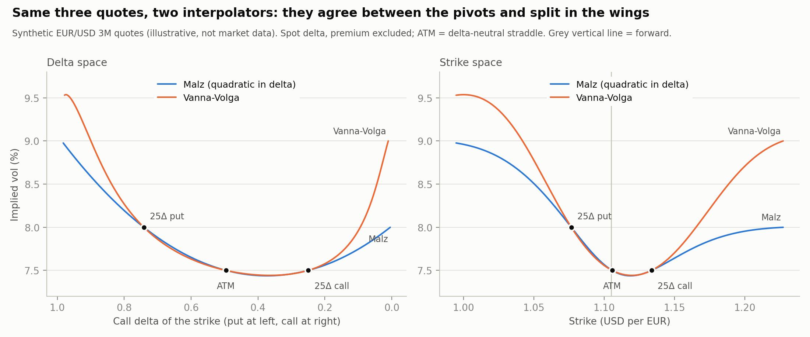
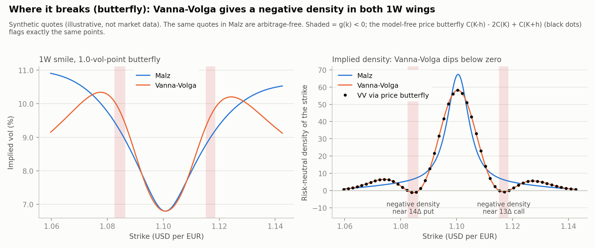
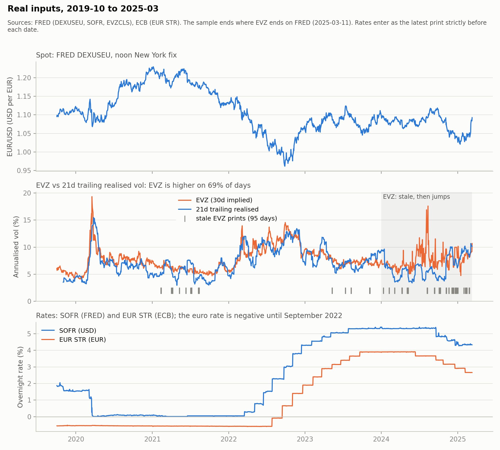

# FX Vol Surface and Options Pricing

This project builds an FX **volatility surface** from the three numbers dealers actually quote for each maturity
(ATM, 25-delta risk reversal and 25-delta butterfly), using FX delta conventions. It then prices options on that
surface with the Garman-Kohlhagen model and computes their Greeks. The surface can be interpolated with a smile model
(this project implements Malz and Vanna-Volga; SABR and SVI are not implemented).

The goal of the final stage is to simulate a **delta-hedged short-volatility book**, to see how the gap between
*realised* and *implied* volatility drives profit and loss. That stage is not built yet (see [Status](#status)).

Free sources do not publish historical vol quotes, so the surface is parameterised from real market data (spot, interest
rates and CBOE's EVZ index) plus **clearly labelled assumptions** for the skew and wings, or from **synthetic**
surfaces for demos and stress tests. [Real, assumed or synthetic?](#real-assumed-or-synthetic) says which is which.

## The idea in plain English

**What gets quoted.** In FX options, dealers do not quote a price for every strike. For each maturity they quote three
numbers, all in volatility terms:

| Quote | What it means | What it does to the smile |
|---|---|---|
| **ATM** | The implied vol of an option struck near the current forward price | Sets the overall *level* |
| **25-delta risk reversal (RR)** | Vol of the 25-delta call minus vol of the 25-delta put | Sets the *tilt*: negative means downside (put) protection costs more |
| **25-delta butterfly (BF)** | Average vol of the two 25-delta wings minus ATM vol | Sets the *curvature*: how much more expensive the wings are than the middle |

**From three numbers to a surface.** Three quotes give three points on a curve. A *smile model* draws a smooth curve
through them, so you can read off a vol for any strike. Repeating this for several maturities and blending between them
gives the full surface. Plots of how RR tilts the smile and BF lifts the wings are in
[`figures/rr_bf_intuition.png`](figures/rr_bf_intuition.png).

**Why "delta convention" matters.** A "25-delta" option is defined by its delta, not its strike, so turning a quote into a
strike depends on conventions that vary by currency pair and maturity: spot or forward delta, with or without the
premium included. Get this wrong and every strike on the surface is slightly off. This project makes the convention a
switchable parameter, with spot delta, premium excluded as the EUR/USD default.

**Pricing.** The Garman-Kohlhagen model is Black-Scholes with two interest rates, one for each currency. Given a strike,
a maturity and a vol from the surface, it gives a price and the Greeks (delta, gamma, vega, theta, vanna and volga).

**Why realised vs. implied vol matters.** Suppose you sell an option and hedge your spot exposure every day. To a
first approximation, your profit is the premium you collected minus what the hedging costs, and that cost is set by
the vol that actually *happens* (realised) compared with the vol you *sold* (implied). If realised vol comes in below
implied, you tend to make money; if it comes in above, you tend to lose. The final stage of this project measures that
on real EUR/USD history.

## Status

| Stage | What it covers | Status |
|---|---|---|
| 1. Core pricer | Garman-Kohlhagen price and Greeks; delta to strike under four delta conventions | Done |
| 2. Single-tenor smile | ATM / RR / BF to a smile; Malz and Vanna-Volga interpolation; smile vs market strangle | Done |
| 3. Full surface | Five maturities, interpolated in total variance; butterfly and calendar arbitrage checks | Done |
| 4. Data | Real spot, rates and EVZ; assumed RR/BF; synthetic stress cases | Done |
| 5. Hedging simulation | Delta-hedged short-vol book, P&L against realised vs. implied vol | **Not started** |

Not implemented: SABR and SVI smiles. Vanna-Volga fails the arbitrage checks under extreme smiles, so an arbitrage-free
parameterisation such as SVI is the natural next improvement.

## Real, assumed or synthetic?

Every number in this project falls into exactly one of three groups. The full table, with sources, is in
[Stage 4](#stage-4-data-and-which-numbers-are-real).

- **Real:** EUR/USD spot (FRED), USD and EUR overnight rates (SOFR from FRED, EUR STR from the ECB), and the EVZ index of
  30-day EUR/USD implied vol (FRED), used as a proxy for 1M ATM vol. The sample runs from 2019-10-02 to 2025-03-11.
- **Assumed:** the 25-delta RR and BF at every maturity. They are fixed fractions of ATM vol, with plausible EUR/USD
  magnitudes, and are **not** calibrated to published quotes. The ATM term structure and the flat rate curve are also assumed.
- **Synthetic:** the quotes used in the demos and tests, and the stress scenarios (extreme skew, extreme butterfly, vol
  spikes, inverted front end).

So the level of vol, spot and rates are real. **Anything about skew or the wings reflects an assumption, not the market.**

## Quick start

```bash
pip install -e ".[dev]"   # numpy, scipy, pandas, pytest, QuantLib, matplotlib
pytest                    # runs offline; a few tests use the real data only if it has been downloaded
```

Build a smile from the three quotes, then price an option on it:

```python
from fxvol import gk
from fxvol.smile import SmileQuote, build_smile

# EUR/USD, 3 months: ATM 7.5%, risk reversal -0.5 vol points, butterfly +0.25 vol points
q = SmileQuote(S=1.10, T=0.25, rd=0.053, rf=0.035, atm=0.075, rr=-0.005, bf=0.0025)
smile = build_smile(q, model="malz")        # or model="vv" for Vanna-Volga

smile.vol_at_delta(-0.25)                   # 0.080: the 25-delta put vol (puts cost more: RR is negative)
vol = smile.vol(1.12)                       # vol at strike 1.12, about 7.44%
gk.price(S=1.10, K=1.12, T=0.25, rd=0.053, rf=0.035, sigma=vol, is_call=True)   # about 0.0099 USD per EUR
```

To reproduce the figures and the real-data pipeline:

```bash
python scripts/plot_smiles.py                # Stage 2 figures (synthetic quotes)
python scripts/surface_demo.py               # Stage 3: arbitrage checks and figures (synthetic quotes)
python scripts/fetch_data.py                 # Stage 4: download the real series
python -I scripts/build_dataset.py           # Stage 4: build and audit the daily dataset
```

## A quick look

The same three quotes, interpolated two ways. The models agree between the quoted points and differ in the wings:



What the arbitrage checks catch: Vanna-Volga produces a negative implied density (shaded), which would allow a free-money
trade, while the same quotes in Malz are arbitrage-free:



The real inputs used from Stage 4 (spot, EVZ against realised vol, and overnight rates):



## Where to look

- **[findings.md](findings.md)**: what was measured, what broke and how it was detected, with the numbers. Start here.
- `fxvol/`: the library. `gk.py` (pricing and Greeks), `delta.py` and `conventions.py` (delta conventions), `smile.py`
  (one maturity), `surface.py` (all maturities), `arbitrage.py` (the checks), `data.py` and `market.py` (real data and
  assumptions), `synthetic.py` (synthetic quotes).
- `scripts/`: runnable demos and the data pipeline. `tests/`: the automated tests.

---

# Details by stage

## Stage 1: core pricer (`fxvol/`)

- `gk.py`: Garman-Kohlhagen `price`, `delta`, `gamma`, `vega`, `theta`, `vanna`, `volga`
  (raw partial derivatives; units documented in the module docstring).
- `delta.py`: `fx_delta` and `delta_to_strike` under all four delta conventions.
  Premium-excluded is closed-form; premium-included uses a bracketed root-finder
  (for calls it returns the larger of the two strikes).
- `conventions.py`: `DeltaConvention(delta_type, premium_included)`.
  **EUR/USD default is spot delta, premium excluded** (`EURUSD_DEFAULT`); every function
  that takes a delta accepts a `convention=` argument to switch.

```python
from fxvol import delta_to_strike, DeltaConvention, DeltaType
K25c = delta_to_strike(0.25, S=1.10, T=0.25, rd=0.053, rf=0.035, sigma=0.08)   # default convention
K25p = delta_to_strike(-0.25, 1.10, 0.25, 0.053, 0.035, 0.08,
                       DeltaConvention(DeltaType.FORWARD, premium_included=True))
```

Validation (`tests/`): put-call parity to a few ulps, every Greek against central finite
differences (bumps scaled to `S*sigma*sqrt(T)`), price/delta/gamma/vega/theta against QuantLib's
analytic European engine, and delta<->strike round trips for all four conventions.

## Stage 2: single-tenor smile (`fxvol/smile.py`)

Quotes (ATM, 25Δ RR, 25Δ BF; vols as decimals) become three nodes (25Δ put, ATM, 25Δ call),
which an interpolator then turns into `vol(K)` and `vol_at_delta(Δ)`.

```python
from fxvol.smile import SmileQuote, build_smile
q = SmileQuote(S=1.10, T=0.25, rd=0.053, rf=0.035, atm=0.075, rr=-0.005, bf=0.0025)
smile = build_smile(q, model="malz", strangle="smile")   # model: "malz" | "vv"; strangle: "smile" | "market"
smile.vol(1.12); smile.vol_at_delta(-0.10)
```

- **ATM** defaults to the delta-neutral straddle (`AtmType.DELTA_NEUTRAL`), switchable to forward.
- **Smile strangle** (default): the quoted BF is used directly as the smile butterfly.
  **Market strangle**: BF is the flat-vol strangle's vol minus ATM; the smile BF is solved by a
  1-D root-find so the strangle reprices (needs a model, so the result is model-dependent).
  On the synthetic EUR/USD 3M example the gap is about 0.004 vol pt (Malz) / 0.005 (VV), and a few
  hundredths of a vol point for ATM 12 / BF 1.0.
- **Malz**: exact quadratic in call delta. **Vanna-Volga**: vega/vanna/volga-matching correction to
  ATM-vol Black prices, inverted back to vols (NaN where no implied vol exists).
- `python scripts/plot_smiles.py` writes `figures/smile_models.png` and `figures/rr_bf_intuition.png`
  (**synthetic quotes**, labelled as such on the plots).


## Stage 3: full surface and arbitrage checks (`fxvol/surface.py`, `fxvol/arbitrage.py`)

Five pillars (1W, 1M, 3M, 6M, 1Y), each with its own `rd`/`rf` and a per-tenor smile (Malz or Vanna-Volga),
joined by **linear interpolation in total variance** `w = sigma^2 T`.

```python
from fxvol.synthetic import eurusd_like          # SYNTHETIC quotes, see fxvol/synthetic.py
from fxvol.arbitrage import check_surface
s = eurusd_like()
s.vol(K=1.12, T=0.4); s.vol_at_delta(-0.25, T=0.4)
print(check_surface(s).summary())
```

- **Interpolation coordinate:** fixed log forward-moneyness `k = ln(K/F_T)`, not fixed strike. The
  no-calendar-arbitrage condition lives in `k`; with carry the forward drifts, so fixed strike is a different
  moneyness at each tenor. Outside the pillars the vol is held flat at fixed `k`.
- **Butterfly (density >= 0)**, two independent detectors that must agree: Gatheral's `g(k)` (from finite
  differences of `w`) and the model-free price butterfly `C(K-h) - 2C(K) + C(K+h)`.
- **Calendar (total variance non-decreasing in T)**, reported both at fixed `k` and at fixed strike.
- Violations carry their location (maturity, `k`, strike, delta); points where a model has no vol (NaN) are
  counted separately, never silently passed.
- `python scripts/surface_demo.py` prints the reports and writes `figures/surface_clean.png`,
  `arb_butterfly.png`, `arb_calendar.png`, `calendar_coordinates.png`. Results are written up in
  [findings.md](findings.md).


## Stage 4: data, and which numbers are real

Every quantity in this project is exactly one of **REAL**, **ASSUMED** or **SYNTHETIC**.

| Quantity | Source | Status | Notes |
|---|---|---|---|
| EUR/USD spot | FRED `DEXUSEU` (Federal Reserve H.10 noon New York buying rate) | **REAL** | USD per EUR, daily, about 10 blank days a year (US holidays) |
| USD rate `rd` | FRED `SOFR` | **REAL** (overnight) | Act/360 simple % converted to continuously compounded act/365. Used as-of the previous available date |
| EUR rate `rf` | ECB `EST` (euro short-term rate) | **REAL** (overnight) | Identical to FRED's mirror of it on all 1,827 overlapping dates (checked). Negative until 2022-09-13 (it first rose to -0.09 on 2022-07-27, and turned positive on 2022-09-14) |
| 30-day implied vol | FRED `EVZCLS` (CBOE EUR/USD ETF Volatility Index) | **REAL** | A VIX-style index from options on an EUR/USD ETF, so closer to a variance-swap level than to ATM vol. Ends 2025-03-11 on FRED; see data quality below |
| Rates across tenors | the overnight rates, held flat | **ASSUMED** | No term structure of rates |
| 1M ATM vol | `EVZ x 0.9614` | **ASSUMED** | The factor makes the model's own 30-day variance-swap vol equal EVZ. Depends on the assumed smile below |
| ATM term structure | Forward variance mean-reverts to the sample mean EVZ (7.75%), `kappa = 2` per year | **ASSUMED** | Calendar-arbitrage-free by construction; `kappa` is a guess |
| 25D RR and BF | Fixed fractions of ATM at each pillar (RR -2.9% to -8.9%, BF 2.2% to 4.4% of ATM) | **ASSUMED** | Plausible EUR/USD magnitudes, **not calibrated to any quote**. They scale with the vol regime because they scale with ATM |
| Stress surfaces (6x skew, 6x butterfly, EVZ 4 and 30, inverted front end) | `fxvol.market.stress_scenarios` on a real day | **SYNTHETIC** | Edge cases; each changes one thing |
| Quotes in the Stage 1-3 demos and tests | `fxvol/synthetic.py` | **SYNTHETIC** | Illustrative only |

Consequence: spot, rates and the level of vol are real. **Anything about skew or the wings is assumed**, so a result
that depends on RR or BF reflects the assumption, not the market.

```bash
python scripts/fetch_data.py                 # downloads data/raw/*.csv + manifest.json (URL, time, SHA-256)
python -I scripts/build_dataset.py           # data/processed/market_state.csv, audit report, two figures
```

Raw and processed CSVs are **not committed** (third-party data; `data/raw/manifest.json` is, so downloads can be verified).
Downloaded files are treated as untrusted: the fetcher only writes them after checking they look like the CSV requested, and
the build is meant to be run with `python -I`.

Alignment rules (details in `fxvol/data.py`): rows need spot and EVZ on the same date; nothing is forward-filled; rates are
the latest print **strictly before** each date; spot is a noon fix while EVZ is a close, a mismatch that is not corrected.

Data quality, found while building this (numbers in [findings.md](findings.md)):

- **The usable window is 2019-10-02 to 2025-03-11** (1,352 days): the EUR STR starts 2019-10-01 and EVZ on FRED ends 2025-03-11, although
  spot and rates run to November 2026. CBOE's own EVZ file returned 403, so the series could not be extended.
- **EVZ has stale prints** (95 sample days in runs of three or more identical values; flagged in `evz_stale`) and from 2024 it updates
  irregularly (stale, then jumps). Treat 2024-2025 EVZ with caution.
- **`long_run_vol` is the full-sample mean of EVZ**, which is look-ahead for any backtest. Use an expanding mean or a fixed value there.
